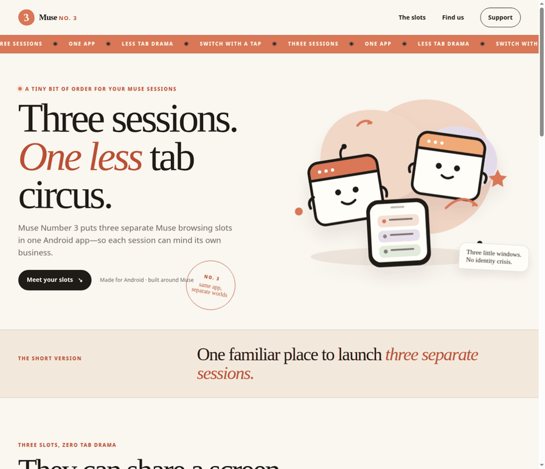
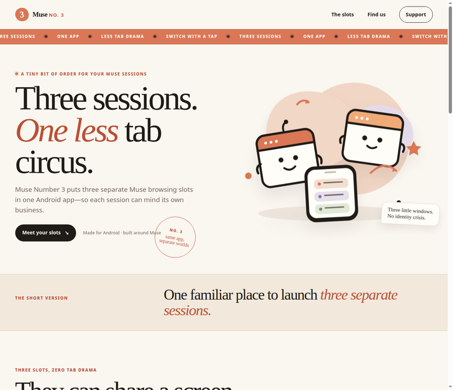
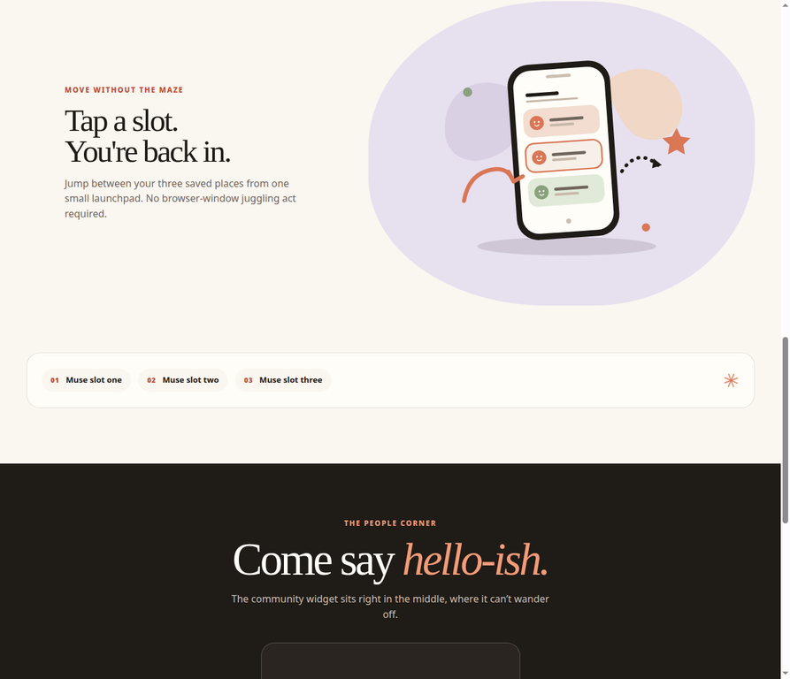

# Muse Number 3

**Three separate Muse sessions, one small Android app.**

> Keep three Muse logins in their own spaces, then switch between them without the browser-tab circus.

**Status:** unreleased scaffold · **Version:** `0.1.0` · **Platform:** Android, `minSdk 26` · **Build:** GitHub Actions workflow included

## Why this exists

When three Muse accounts live in one browser, it is easy to lose track of which session is active. Cookies, open chats, and account state all end up competing for the same space. Switching becomes a memory test instead of a useful workflow.

Muse Number 3 makes the boundary explicit: one Android app, three named WebView slots, three AndroidX WebKit Multi-Profile sessions. Each slot owns its own cookies and web storage. Switching changes visibility, not the page underneath, so a chat can stay open while you move to another slot.

That separation is intentional. If a device cannot provide WebView Multi-Profile support, the app stops at an unsupported-device screen instead of silently merging sessions.

## See it work

There is **no public live demo or APK yet**. The Android app is still a personal project scaffold, and the three default URLs are placeholders that all point to `https://muse.ai` until the final Muse instance URLs are chosen.

The repository does include a real static promo page. It has no package manager, build step, or server dependency:

```sh
python3 -m http.server 8000 --directory site
# open http://127.0.0.1:8000
```



The fastest code path to the Android behavior is [`SlotConfig.kt`](app/src/main/java/com/fedos/musenumberthree/SlotConfig.kt), which is the single source of truth for the three labels, URLs, and profile names. The release-critical manual scenario is documented in [`docs/QA.md`](docs/QA.md).

## Screenshots

These are rendered captures of the checked-in static promo page, served locally from `site/`—not mockups of the Android app.

| The first impression | Separate sessions | Switch with a tap |
| --- | --- | --- |
|  |  |  |

## Quick start

### Run the real static demo

```sh
python3 -m http.server 8000 --directory site
# visit http://127.0.0.1:8000
```

### Prepare the Android build

The Android app needs Java 17+ and an Android SDK. The Gradle 9.6.0 wrapper is committed at the repository root; a machine-specific `local.properties` file is not checked in.

```sh
# check prerequisites; this does not install anything
./scripts/install-deps.sh

# build a debug APK
./scripts/build.sh
```

The debug APK, when the build environment is configured, is written to:

```text
app/build/outputs/apk/debug/app-debug.apk
```

There is no published download yet. Release signing and the tag-based CI release flow are documented in [`docs/SIGNING.md`](docs/SIGNING.md).

### Test

There are no automated tests in v1. The important test is manual because it requires three real logins on a WebView provider that supports Multi-Profile:

```text
1. Install the debug APK on a supported Android device.
2. Log slot 1 into account A, slot 2 into account B, and slot 3 into account C.
3. Switch through all three twice.
4. Confirm every account remains isolated and no slot adopts another slot's session.
```

Use the complete checklist in [`docs/QA.md`](docs/QA.md), including swipe switching, launcher shortcuts, rotation, relaunch, logout isolation, and the unsupported-device path.

## How the app works

- **Three persistent slots.** `SlotController` creates the three WebViews once and keeps hidden slots attached rather than destroying or reloading them.
- **Three isolated profiles.** `ProfileSupport` applies `WebViewCompat.setProfile()` before any other WebView operation, using `muse-slot-1`, `muse-slot-2`, and `muse-slot-3`.
- **One navigation owner.** Tap the always-visible switcher bar, swipe across it, or use an app-icon shortcut; all routes go through `SlotNavigator`.
- **No unsafe fallback.** If `MULTI_PROFILE` is unsupported, the app shows the unsupported screen before creating WebViews.

The current configuration is deliberately easy to audit:

```kotlin
SlotDef(1, "Muse 1", "https://muse.ai", "muse-slot-1")
SlotDef(2, "Muse 2", "https://muse.ai", "muse-slot-2")
SlotDef(3, "Muse 3", "https://muse.ai", "muse-slot-3")
```

Those three URLs are placeholders, not three distinct production instances.

## Project map

```text
app/                         Native Kotlin Android app
app/src/main/java/...        Slot, profile, navigation, and WebView logic
app/src/main/res/            Layouts, icons, launcher shortcuts, and themes
site/                        Static promo page and local illustrations
assets/demo/                 Real rendered promo-page screenshots and GIF
scripts/build.sh             Debug APK build helper
scripts/install-deps.sh      Prerequisite check only
scripts/deploy-pages.sh      Cloudflare Pages direct-upload helper
docs/QA.md                   Manual release checklist
docs/SIGNING.md              Release keystore and CI signing rules
docs/SESSION-BEHAVIOR.md     Profile and persistence invariants
.github/workflows/build.yml  Debug CI and draft release workflow
```

## Deployment notes

The static promo page can be published from `site/` as-is, or from the repository root through the forwarding [`index.html`](index.html). For Cloudflare Pages Git integration, use `exit 0` as the build command and `site` as the build output directory. For a direct upload, run `./scripts/deploy-pages.sh` (equivalent to `npx wrangler pages deploy site`). Do not use `npx wrangler deploy`; that is the Worker command and is what causes a missing Worker entry-point error here. GitHub Pages is **not enabled automatically**: there is no Pages workflow in this repository. Full instructions are in [`site/DEPLOYMENT.md`](site/DEPLOYMENT.md).

Before publishing the site, configure only public destinations in [`site/config.js`](site/config.js). Discord and payment destinations are blank by default, and payment controls remain hidden until a valid HTTPS destination and age-gate flow are configured.

## License and support

The checked-in [`LICENSE`](LICENSE) is a proprietary draft and says its terms are still to be finalized. Treat the project as all rights reserved until the owner replaces that draft with final terms.

Questions and support: **museai@fedpromptly.com**
