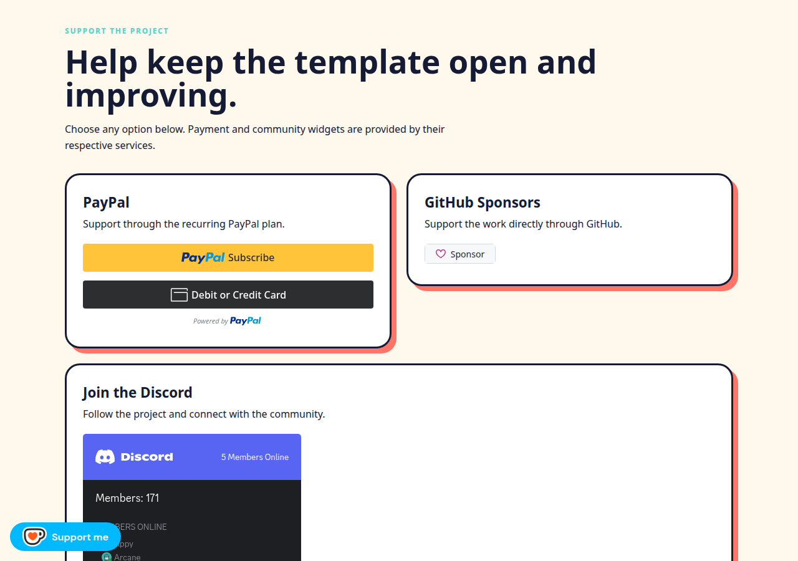
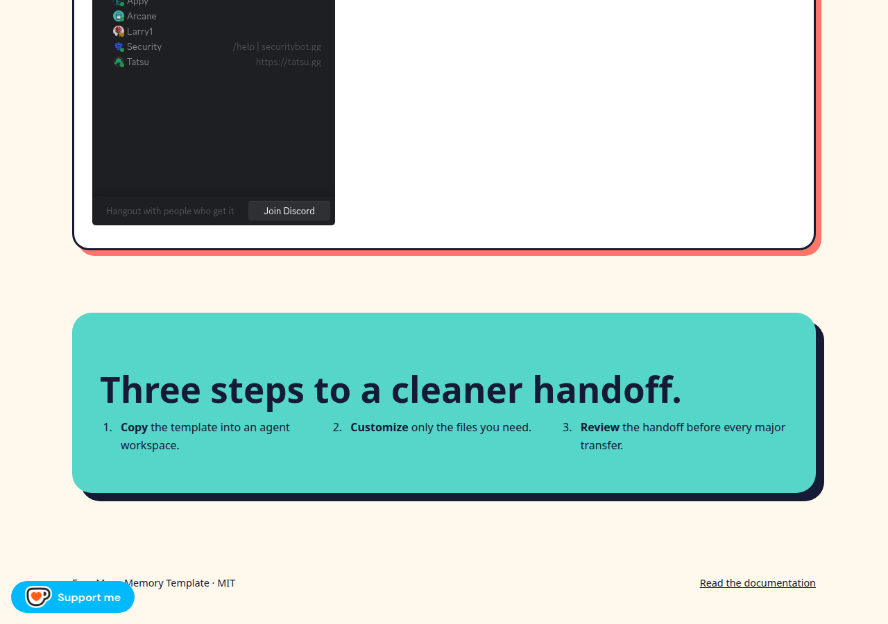

# Face Muse Memory Template

[](LICENSE)

**A small, versioned memory bundle that helps AI agents carry forward the rules, preferences, tasks, and handoff context that matter.**

Face Muse is a public starter template—not an agent runtime. Copy the `templates/` directory into an agent workspace, fill in the placeholders, and keep durable memory separate from transcripts, credentials, media, and stale export archives.

## Why this exists

AI agents often lose the important parts between sessions: how they should answer, what they are allowed to do, what is currently in progress, and which decisions already happened. Throwing an entire conversation export at the next agent is slow, difficult to review, and risky when secrets or personal data are mixed in.

This project makes the handoff explicit. Rules, preferences, current state, tasks, decisions, lessons, and append-only events each have a predictable home. Markdown stays readable to people; JSON and JSONL stay easy for tools to process.

The project is intentionally modest. It gives you a format and a workflow, not a magic memory engine. There is no runtime loader, database, hosted API, or claim that an agent will obey memory automatically.

## See it work

**Live demo:** not published yet. The repository contains a working static demo page that can be run locally.

### Run the real demo locally

```bash
cd face-muse-memory
python3 -m http.server 8765 --directory site
```

Open <http://127.0.0.1:8765/>. The page is the actual `site/index.html`, served with its real favicon, promotional artwork, support widgets, and Cloudflare Pages-compatible asset paths.

### Preview






A short animated capture of the same local page is available here: [view the real demo GIF](assets/demo/face-muse-demo.gif).

## What you get

```text
face-muse-memory/
├── templates/
│   ├── identity.md              # who the Muse is and how it works
│   ├── soul.md                  # enduring voice and behavior
│   ├── memory.md                # durable user context
│   ├── avatar.md                # visual and social-profile starter
│   ├── standing-rules.md        # shared safety and authorization rules
│   ├── user-preferences.md      # user-specific preferences
│   ├── current-handoff.md       # what is active and what happens next
│   ├── tasks.md                 # current task state
│   ├── decisions.md             # durable decisions and rationale
│   ├── lessons.md               # verified mistakes and prevention rules
│   ├── events.jsonl             # append-only event history
│   ├── index.json               # machine-readable bundle index
│   └── secrets.example.yaml     # references only; never real credentials
├── site/                        # static landing page and deployable assets
├── docs/                        # format, release, and deployment guidance
├── scripts/                     # packaging and checksum helpers
└── .github/workflows/           # release workflow for template ZIPs
```

The main example is the `templates/` directory itself. It is deliberately generic: no names, handles, locations, account IDs, personal history, transcripts, or secrets are included.

## Quick start

### 1. Copy the template

```bash
cp -R templates/ my-agent-memory/
```

### 2. Fill in the starter files that define the agent

Edit:

```text
my-agent-memory/identity.md
my-agent-memory/soul.md
my-agent-memory/memory.md
my-agent-memory/standing-rules.md
```

Then update `current-handoff.md` with active work and next actions. Load memory in this order:

```text
identity → soul → memory → standing-rules → current-handoff → tasks → relevant project
```

### 3. Validate the structured files

```bash
python3 -m json.tool templates/index.json >/dev/null
python3 - <<'PY'
import json
for line in open("templates/events.jsonl"):
    if line.strip():
        json.loads(line)
print("JSONL OK")
PY
(cd templates && sha256sum -c checksums.sha256)
```

### 4. Build a portable template archive

```bash
bash scripts/package-template.sh v0.2.0
```

This creates `dist/face-muse-templates-v0.2.0.zip`. The current repository contains this local release artifact; no public GitHub Release URL is claimed yet.

## How the format works

| Layer | File format | Purpose |
|---|---|---|
| Durable memory | Markdown with YAML front matter | Human-readable rules, preferences, decisions, and lessons |
| Current state | Markdown | Active projects, blockers, approvals, and next actions |
| Event history | JSONL | Append-only actions and observations |
| Bundle index | JSON | File paths, kinds, and statuses for tooling |
| Credential references | YAML example only | Points to an external secure store without storing values |
| Integrity | SHA-256 manifest | Detects accidental changes or omissions |

Personality presets are planned for `0.2.0`. When added, they will override tone and style only; they will not override shared rules, privacy requirements, authorization boundaries, or secret handling.

## Static site deployment

The deployable site is `site/`. It is self-contained and configured for static hosting:

- Cloudflare Pages build output directory: `site`
- Build command: none, or `echo no-build`
- Cloudflare configuration: [`wrangler.toml`](wrangler.toml)
- Deployment notes: [`docs/deploy-cloudflare.md`](docs/deploy-cloudflare.md)
- GitHub release workflow: [`.github/workflows/release.yml`](.github/workflows/release.yml)

A live URL is not configured in this repository. The demo's GitHub links still use a placeholder repository URL and must be replaced before publishing.

The editable social-card and carousel starter page is [`site/social-cards.html`](site/social-cards.html). It introduces the identity, soul, memory, and avatar layers without claiming a live social integration. The raw Patreon checkout URL supplied during planning is intentionally not stored because it contains OAuth-style query parameters; use a clean public campaign URL in a branded deployment.

## Security boundary

Do not commit tokens, passwords, cookies, private keys, webhook URLs, `.env` files, or raw personal exports. Do not place a secret value in `secrets.example.yaml`; use a reference such as `secure://service/environment` instead.

Treat transcripts, media, and ZIP archives as source material. Review and promote only the small amount of context the next agent actually needs.

## Current limitations

- No runtime memory loader is included.
- No database, hosted API, or synchronization service is included.
- No automated test suite is included; the commands above validate the current JSON, JSONL, and checksum formats.
- No public live demo or GitHub remote is configured in this checkout.
- The support widgets on the demo page depend on external PayPal, Ko-fi, GitHub, and Discord services.

## Project files

- [`templates/README.md`](templates/README.md) — copy-and-use instructions
- [`templates/memory.md`](templates/memory.md) — durable memory starter
- [`templates/soul.md`](templates/soul.md) — character and behavior starter
- [`templates/identity.md`](templates/identity.md) — Muse onboarding starter
- [`templates/avatar.md`](templates/avatar.md) — visual/profile starter
- [`docs/social-cards.md`](docs/social-cards.md) — social-card and carousel instructions
- [`docs/optional-brand-links.md`](docs/optional-brand-links.md) — optional branded links and Patreon safety note
- [`docs/memory-format.md`](docs/memory-format.md) — front-matter contract and promotion gate
- [`docs/personality-format.md`](docs/personality-format.md) — planned personality overlay format
- [`docs/release-checklist.md`](docs/release-checklist.md) — validation and publishing checklist
- [`CONTRIBUTING.md`](CONTRIBUTING.md) — public-safe contribution rules
- [`LICENSE`](LICENSE) — MIT License
